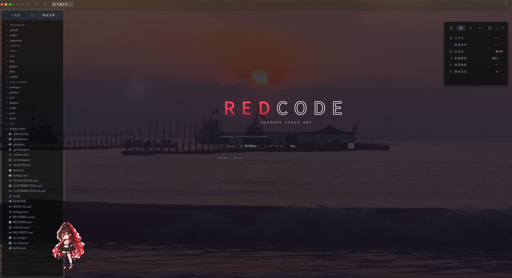

# ⚡ RedCode

**RedCode is a multi-model AI coding agent for both the terminal (TUI) and desktop (GUI).**

It understands and edits code, runs commands, uses developer tools, and works with you in natural language to get real development work done.

Deeply developed from [OpenCode](https://github.com/anomalyco/opencode), RedCode is tailored to Chinese-language workflows and personalized collaboration.

[](CHANGELOG.md)
[](https://github.com/JiaHuiRed/RedCode)
[](https://typescriptlang.org)
[](https://bun.sh)
[](LICENSE)

<p align="center">
  
</p>

<p align="center">
  
</p>

## ❤️ Why RedCode?

**Choose your models freely.** Connect coding plans, compatible APIs, or local models from different providers, and pick the right model for each task without being tied to one service.

**Put AI to work on real development.** File editing, terminal commands, code search, MCP tools, and subagents come together in a complete development workflow.

**Built for long-running collaboration.** Session management, context compaction, prefix-cache management, and memory help carry complex work forward.

**Make every token count.** Optimize prompt prefixes, cache reuse, and context management across models and providers to reduce overhead and make long-running tasks more stable and cost-efficient.

**More than a personality-free tool.** The Soul system lets you customize your AI partner's identity and interaction style, keeping that persona consistent across TUI and GUI sessions.

**Keep control in your hands.** Plan, RedMind, and Auto permission modes let you choose how much freedom the AI has for each task.

## 🚀 Quick Start

Requires Windows 10/11, Git, and Bun 1.3+.

```bash
git clone https://github.com/JiaHuiRed/RedCode.git
cd RedCode
bun install

# Terminal
bun dev

# Desktop
bun run dev:desktop
```

After the first launch, configure your model provider to get started.

For installation, model setup, permissions, and Soul configuration, see [MANUAL.md](MANUAL.md) (Chinese).

## 📖 Documentation

- [User manual](MANUAL.md) — installation, configuration, and usage
- [Changelog](CHANGELOG.md) — release changes and fixes

## 💙 Acknowledgments

RedCode is based on [OpenCode](https://github.com/anomalyco/opencode). Thanks to the original project and the open-source community.

This project is licensed under the [MIT License](LICENSE).
