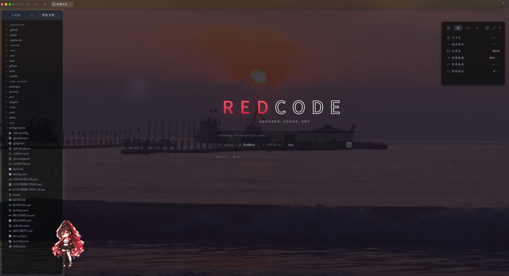

# ⚡ RedSpace

**RedSpace is a Chat + Code AI workspace, available in the terminal (TUI) and desktop (GUI).**

Chat continues an existing companion's personal archive and long-term memory while retaining access to real tools. Code builds on RedCode's multi-model coding, debugging, review, and execution workflows.

Beginning with 0.19.0, RedCode evolves into RedSpace: one runtime for identity, conversations, and meaningful work.

[](CHANGELOG.md)
[](https://github.com/JiaHuiRed/RedCode)
[](https://typescriptlang.org)
[](https://bun.sh)
[](LICENSE)

<p align="center">
  
</p>

<p align="center">
  
</p>

## ❤️ Why RedSpace?

**Choose your models freely.** Connect coding plans, compatible APIs, or local models from different providers, and pick the right model for each task without being tied to one service.

**Put AI to work on real development.** File editing, terminal commands, code search, MCP tools, and subagents come together in a complete development workflow.

**A desktop workspace, not just a chat box.** Keep the file tree, change review, terminal, and context dashboard together. Choose your theme, Soul, and reasoning effort where the model supports it.

**Built for long-running collaboration.** Session management, context compaction, prefix-cache management, and memory help carry complex work forward.

**Make every token count.** Optimize prompt prefixes, cache reuse, and context management across models and providers to reduce overhead and make long-running tasks more stable and cost-efficient.

**More than a personality-free tool.** The Soul system lets you customize your AI partner's identity and interaction style, keeping that persona consistent across TUI and GUI sessions.

**Keep control in your hands.** Plan, RedMind, and Auto permission modes let you choose how much freedom the AI has for each task.

## 🚀 Quick Start

Requires Windows 10/11, Git, and Bun 1.3+.

```bash
git clone https://github.com/JiaHuiRed/RedCode.git
cd RedCode
bun install

# Terminal
bun dev

# Desktop
bun run dev:desktop
```

After the first launch, connect your own model provider or local model. Model service credits are not included. See [Add an AI model](MANUAL.md#21-添加-ai-模型) for configuration examples (Chinese).

Keep API keys and machine-specific paths in your local `~/.redcode/redcode.local.jsonc`, not in version control.

For installation, model setup, permissions, and Soul configuration, see [MANUAL.md](MANUAL.md) (Chinese).

## RedSpace: Chat and Code

Version 0.19.0 starts the transition to two product modes sharing the same backend and personal archive in TUI and GUI:

- **Code** keeps existing development workspaces, Souls, engineering memory, and permission modes.
- **Chat** imports an existing OpenClaw / RedClaw companion's identity, long-term memory, and diaries. The same companion can also use tools for practical work.

In the terminal, import with `redcode companion import <directory-or-zip> --id companion`, then open `redspace --companion companion`. Use `/chat` and `/code` during a local TUI session. The original `redcode` CLI remains compatible. When running from source, replace `redspace` with `bun dev`. In the GUI, use the Chat entry in the title bar.

This first slice supports archive continuity and selective memory writes. Historical JSONL conversation reconstruction, heartbeat, dreams, and old scheduled jobs are follow-up work. Existing source directories, CLI names, and local configuration paths remain compatible. See the [manual](MANUAL.md#65-redspace-chat-个人档案) for migration boundaries.

## 📖 Documentation

- [User manual](MANUAL.md) — installation, configuration, and usage
- [Changelog](CHANGELOG.md) — release changes and fixes

## 💙 Acknowledgments

RedSpace evolved from RedCode. The historical source includes open-source work from [OpenCode](https://github.com/anomalyco/opencode); its licenses, copyright notices, and history remain intact. Thanks to the original project and community.

This project is licensed under the [MIT License](LICENSE).
