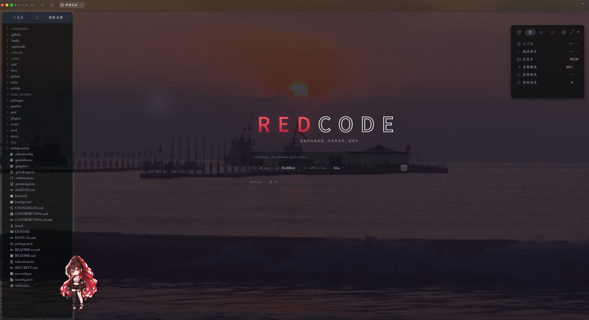

# ⚡ RedSpace

**RedSpace 是一个拥有 Chat 与 Code 双模式的 AI 协作空间，同时支持终端（TUI）与桌面（GUI）。**

Chat 能接续原有伙伴的人格和长期记忆，并按需召回导入档案中的可识别旧对话，也能直接调用工具完成任务；Code 保留 RedCode 的多模型编程、调试、文件操作与工程工作流。

自 0.19.0 起，RedCode 演进为 RedSpace：在同一底层延续人格、会话与执行能力。

[](CHANGELOG.md)
[](https://github.com/JiaHuiRed/RedCode)
[](https://typescriptlang.org)
[](https://bun.sh)
[](LICENSE)

<p align="center">
  
</p>

<p align="center">
  
</p>

## ❤️ Why RedSpace?

**自由选择模型。** 接入不同供应商的 Coding Plan、兼容 API 或本地模型，根据任务选择适合的模型，而不受限于单一服务。

**让 AI 真正参与开发。** 文件编辑、终端执行、代码检索、MCP 工具和子代理共同组成完整的开发工作流。

**桌面工作台，不只是聊天窗口。** 文件树、变更审查、终端与上下文看板放在同一界面；主题、Soul 和模型支持的推理强度都可以自行选择。

**适合长期协作。** 通过会话管理、上下文压缩、前缀缓存管理和记忆系统，支持持续推进复杂任务。

**让每个 Token 更有价值。** 针对不同模型与服务商优化提示词前缀、缓存复用和上下文管理，减少重复开销，让长任务运行得更稳定、更经济。

**不只是一个没有个性的工具。** Soul 系统允许自定义 AI 伙伴的身份与交互风格，并在 TUI 和 GUI 中保持会话人格一致。

**把控制权留给使用者。** Plan、RedMind、Auto 三种权限模式，按任务需要控制 AI 的执行范围。

## 🚀 快速开始

需要 Windows 10/11、Git 和 Bun 1.3+。

```bash
git clone https://github.com/JiaHuiRed/RedCode.git
cd RedCode
bun install

# 终端
bun dev

# 桌面
bun run dev:desktop
```

首次启动后，需要接入自己的模型供应商或本地模型，软件不附带模型服务额度。配置示例见手册的[添加 AI 模型](MANUAL.md#21-添加-ai-模型)。

密钥和机器专属路径放在本机的 `~/.redcode/redcode.local.jsonc`，不要提交到仓库。

更多安装、模型接入、权限与 Soul 配置说明见 [MANUAL.md](MANUAL.md)。

## 两种模式：Chat 与 Code

0.19.0 开始在同一个应用中提供两个模式，TUI 与 GUI 共用后端和个人档案：

- **Code**：继续使用现有开发工作区、Soul、工程记忆和权限模式。
- **Chat**：导入已有 OpenClaw / RedClaw 个人档案，接续同一个伙伴的人格、长期记忆、日记和可识别的旧对话文本，也可以使用工具完成工作。

TUI 推荐用 `redspace companion import <目录或ZIP> --id companion` 导入，再用 `redspace --companion companion` 进入（原 `redcode` 命令仍兼容）；运行中使用 `/chat` 与 `/code`。源码运行时把 `redcode` 换成 `bun dev`。GUI 使用顶栏 Chat 入口导入并开始聊天。

首阶段接通档案继承与选择性记忆续写；0.19.1 起可从同一 OpenClaw 身份的历史中提取可识别对话文本并按需召回。完整旧会话与工具轨迹重建、心跳、梦境和旧定时任务仍待后续接入。旧源码目录、CLI 命令与本地配置路径保持兼容。操作与迁移边界见[手册](MANUAL.md#65-redspace-chat-个人档案)。

## 📖 文档

- [用户手册](MANUAL.md) — 安装、配置与使用方法
- [更新日志](CHANGELOG.md) — 版本变化与修复记录

## 💙 致谢

RedSpace 从 RedCode 演进而来，历史源码包含 [OpenCode](https://github.com/anomalyco/opencode) 的开源成果；许可证、版权及贡献历史保留。感谢原项目与相关开源社区。

本项目采用 [MIT License](LICENSE)。
